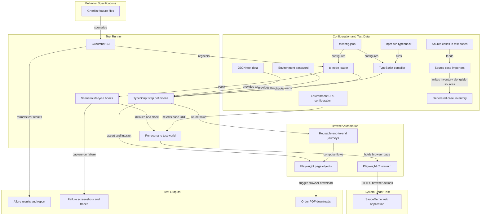
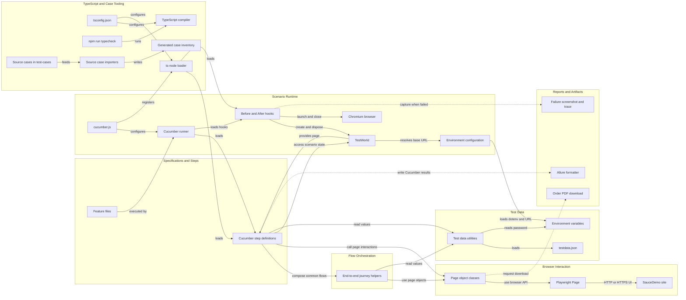

# Architecture Diagram

This repository contains a TypeScript-based browser automation suite for SauceDemo, not the application being tested. Cucumber scenarios orchestrate Playwright page objects against a configured SauceDemo environment and produce local reports and failure artifacts.

## Application Architecture

<!-- mermaid-checked: no \n, no em-dash/en-dash, no {} in labels, subgraphs are id["label"], arrows are -->|"label"|, all subgraphs closed by end, ids unique -->

### Technology Stack Summary

| Layer | Technology | Version | Purpose |
|---|---|---:|---|
| Specifications and runner | Gherkin, Cucumber.js | Cucumber 13.3.0 | Express scenarios and execute step definitions |
| Automation | TypeScript, Playwright, Chromium | TypeScript 5.9.3; Playwright 1.65.0 | Drive and inspect the browser |
| TypeScript tooling | tsconfig.json, ts-node, TypeScript | ts-node 10.9.2; TypeScript 5.9.3 | Share compiler settings with type-checking and Cucumber loading |
| Environment configuration | dotenv, Node.js | dotenv 16.6.1; Node.js 22.12+ | Load environment selection and URL from process environment |
| Test data | JSON, environment variables, test-cases/ | N/A | Store source cases, generated inventory, and non-secret runtime values |
| Reporting | Allure Cucumber adapter and CLI | 3.14.0; 2.34.0 | Write results and generate an HTML report |

### Data Storage & External Services

The test suite has no application database, cache, or message broker. Source case documents and generated case inventories share `test-cases/`; non-secret user, product, and checkout values are read from `test-data/testdata.json`. The password and environment-specific base URL are supplied through environment variables. Playwright drives the configured SauceDemo web application over HTTP or HTTPS. Cucumber Allure results, failure screenshots, traces, and downloaded order PDFs are written to local report/output directories.

### Key Architectural Decisions

- Gherkin features are the behavior specifications; Cucumber step definitions bind them to TypeScript automation.
- Page objects and reusable journeys organize browser interactions; each scenario gets an isolated browser context and page with failure screenshots and traces.
- `tsconfig.json` configures type-checking and ts-node; source cases and generated inventories share `test-cases/`. Cucumber remains the active runner, separate from Playwright Test configuration.

## Component Relationships

<!-- mermaid-checked: no \n, no em-dash/en-dash, no {} in labels, subgraphs are id["label"], arrows are -->|"label"|, all subgraphs closed by end, ids unique -->

### Component Inventory

| Component | Layer | Type | Responsibility |
|---|---|---|---|
| `features/*.feature` | Specifications | Gherkin scenarios | Describe login, inventory, cart, checkout, order, and session behavior |
| `src/steps/*.steps.ts` | Presentation | Cucumber step definitions | Bind Gherkin steps to assertions, flows, and page interactions |
| `src/support/e2e-journeys.ts` | Flow orchestration | Journey helpers | Compose reusable configured login and checkout sequences |
| `src/pages/*.ts` | Browser interaction | Page objects | Encapsulate selectors and interactions for login, inventory, cart, checkout, and order completion |
| `src/support/hooks.ts` | Scenario runtime | Cucumber hooks | Launch Chromium, create context/page, capture failure artifacts, and clean up |
| `src/support/world.ts` | Scenario runtime | Cucumber World | Hold per-scenario browser state and expose the selected base URL |
| `config/environments.ts` | Scenario runtime | Configuration module | Validate `TEST_ENV` and its matching absolute HTTP(S) base URL |
| `tsconfig.json` | TypeScript tooling | TypeScript project configuration | Define shared compiler options and included TypeScript files for type-checking and ts-node |
| `test-cases/` | Case tooling | Source documents and generated inventory | Keep source cases and imported case artifacts in one directory |
| `src/utils/test-data.ts` | Test data | Data access utility | Read typed test inputs and require password from its configured environment variable |
| `test-data/testdata.json` | Test data | JSON data store | Supply non-secret login, product, and checkout values |
| `cucumber.js` | Runner and outputs | Cucumber configuration | Discover features and TypeScript support/step files; configure Allure formatting |
| Allure formatter | Reports and artifacts | Cucumber reporter | Write machine-readable test results for report generation |
| Failure artifacts | Reports and artifacts | Screenshot and trace files | Preserve browser evidence for failed scenarios |
